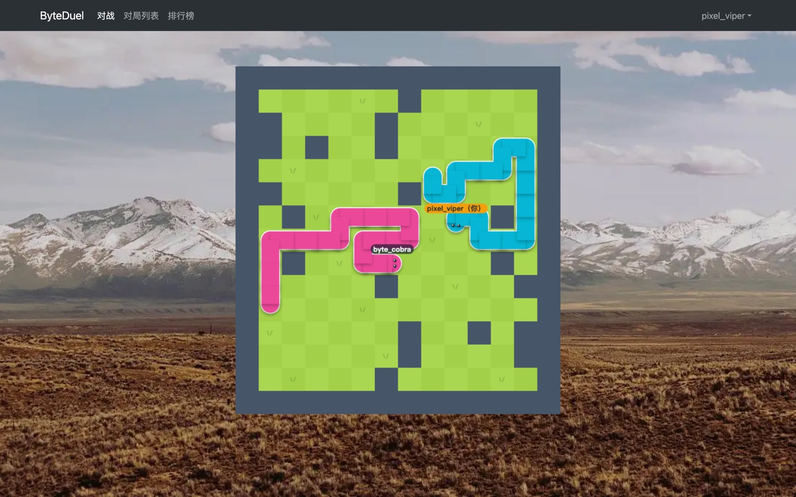

# ByteDuel

**Write a bot, then send it into a real-time snake duel against other players.**

Live at **[byteduel.de5.net](https://byteduel.de5.net)**



ByteDuel is an online two-player snake game. You can play with the keyboard, or write a bot in **C++, Java, Python or Go** and let it play for you. Players are matched by rating. Bot code runs on the server in an isolated sandbox. Every match is saved and can be replayed.

## Features

- **Real-time matches over WebSocket.** Both snakes move at the same time, once per turn.
- **Bots in four languages.** Each language comes with an in-browser editor (Ace) and a starter template. Code is compiled when you save, so a bot that does not compile is rejected before it is stored.
- **Sandboxed execution.** Bot code runs in [go-judge](https://github.com/criyle/go-judge) with no network access and limits on CPU time, memory and number of processes.
- **Rating-based matchmaking.** The allowed rating gap between two players grows the longer they wait in the queue.
- **Ranklist and match replays.** Records are paginated, and any finished game can be replayed move by move.
- **Accounts.** Login uses JWT. After repeated failed logins, the account is locked for a while.

## How the game works

- The board is 15 × 14 cells, surrounded by walls and with 20 inner walls. The inner walls are placed symmetrically through the board's center, so both players face the same layout. A BFS check guarantees that the two starting corners are connected.
- Each turn, both players choose a direction at the same time. A snake grows on each of its first 10 steps, and on every 3rd step after that.
- A snake loses if it runs into a wall, into itself or into the other snake, or if it does not move within 5 seconds. If both snakes lose on the same turn, the game is a draw.
- The winner gains 5 rating points and the loser loses 2.

### Writing a bot

Your bot is run once per turn. It reads one line from stdin and prints a direction to stdout: `0` up, `1` right, `2` down, `3` left.

```
map#my_sx#my_sy#(my_steps)#opp_sx#opp_sy#(opp_steps)
```

- `map` is the 15 × 14 board as a row-by-row string of `0`s and `1`s, where `1` is a wall.
- `sx`, `sy` give each snake's starting cell.
- `steps` lists every move that snake has made so far, for example `(0121)`.

The starter templates in [web/src/utils/botTemplate.js](web/src/utils/botTemplate.js) already parse this input and rebuild both snakes' bodies, so you only need to write the strategy.

## Architecture

```
Browser ──HTTPS──> Cloudflare ──> web (Caddy: static Vue app, reverse proxy)
                                    │  /api/*, /websocket/*
                                    ▼
                                 backend :8080 ──────────> PostgreSQL
                                  │     ▲
                     add/remove   │     │ "match found"
                                  ▼     │
                             matchingsystem :8081

                                 backend ── run bot ──> botrunningsystem :8082 ──> sandbox (go-judge)
                                    ▲                        │
                                    └──── bot's move ────────┘
```

| Service | Role |
|---|---|
| **web** | Caddy serves the built Vue 3 frontend and proxies the API and WebSocket traffic to backend. It also blocks the internal `/api/pk/*` endpoints from outside access. |
| **backend** | Spring Boot. Handles accounts, bots, records and the ranklist, and runs the game loop. Each match runs on its own thread, which checks collisions, pushes moves to both clients over WebSocket and saves the result. |
| **matchingsystem** | Holds the matchmaking pool. It tries to pair players once per second and calls backend when it finds a match. |
| **botrunningsystem** | Queues bot moves and compiles or runs code through go-judge. Compiled programs are cached in go-judge, and both bots are compiled before the match starts, so turns stay within the time limit. |
| **sandbox** | go-judge with g++, JDK 21, Python 3 and Go installed. It is reachable only on the internal Docker network. |
| **postgres** | PostgreSQL 18, with three tables: `users`, `bots`, `records`. |

The services authenticate each other with a shared `X-Internal-Token` header. Only the web container publishes ports.

## Tech stack

**Frontend:** Vue 3, Vite, Pinia, Vue Router, Bootstrap 5, Ace editor, Canvas 2D for the game
**Backend:** Java 25, Spring Boot 4, Spring Security, Spring WebSocket, MyBatis-Plus, JJWT
**Infrastructure:** PostgreSQL 18, go-judge, Caddy, Docker Compose, Cloudflare

## Running locally

You need Docker with the Compose plugin.

```bash
git clone git@github.com:Wildlife7609/ByteDuel.git
cd ByteDuel
cp .env.example .env
```

Fill in the three secrets in `.env`:

```bash
openssl rand -hex 24      # DB_PASSWORD
openssl rand -base64 32   # JWT_SECRET
openssl rand -hex 24      # INTERNAL_TOKEN
```

Then build and start everything:

```bash
docker compose up -d --build
```

Open http://localhost, register two accounts in two browser windows (one of them in incognito), and start matching. The first build downloads Maven and npm dependencies and the compilers, so it takes 5–15 minutes.

The sandbox container runs with `privileged: true`, because go-judge needs to create its own namespaces and cgroups.

## Deployment

Production deployment is documented in [deploy/README.md](deploy/README.md). It covers TLS with a Cloudflare Origin certificate, firewall rules, database backups and troubleshooting.

## Project layout

```
backendcloud/
  backend/           Spring Boot app: API, WebSocket, game loop
  matchingsystem/    matchmaking service
  botrunningsystem/  bot queue + go-judge client
  sandbox/           go-judge image with compilers
  db/schema.sql      database schema
web/                 Vue 3 frontend + Caddyfile
deploy/              deployment guide
docker-compose.yml
```

## Background

ByteDuel started as the King of Bots project from AcWing's Spring Boot course. The course version compiles bots with joor inside the bot service's own JVM, so it supports only Java and has no isolation, and it stores data in MySQL.

On top of that version, I added:

- **Sandboxed bots in four languages.** C++, Java, Python and Go bots compile and run in go-judge with CPU, memory and process limits and no network access. The Go standard library is prebuilt into the sandbox image to cut compile time from about 6s to 0.9s.
- **Compile checks and caching.** A bot that does not compile is rejected when it is saved. Compiled binaries are cached and both bots are compiled before a match starts, so every turn stays within the 5-second limit.
- **Deployment.** Docker Compose on an ARM VM behind Cloudflare and Caddy, with end-to-end TLS. The database moved from MySQL to PostgreSQL.
- **Security.** Services authenticate each other with a shared secret compared in constant time, Caddy blocks internal endpoints from the outside, and an account is locked for 10 minutes after 5 failed logins. The frontend shows the lockout message.
- **Accounts and bots.** Each user can keep up to 10 bots, and new bots start from a template in the chosen language. An account plays from one window at a time: opening the game in a new window closes the old connection.
- **Stack.** Upgraded to Java 25 and Spring Boot 4, and services call each other with `RestClient` instead of `RestTemplate`.
- **UI.** A redesigned look: papercraft-style snakes on a grass board, with usernames shown above the snake heads and your own snake highlighted.
- **Fixes.** A backtracking DFS in map generation could stall game start for 20 seconds; it is now a BFS. The frontend no longer drops moves and shows wrong results when a tab is in the background. go-judge crashed on arm64 because its seccomp profile was missing a syscall; I reported it upstream ([criyle/go-judge#202](https://github.com/criyle/go-judge/issues/202)), and it was fixed in v1.13.3.
